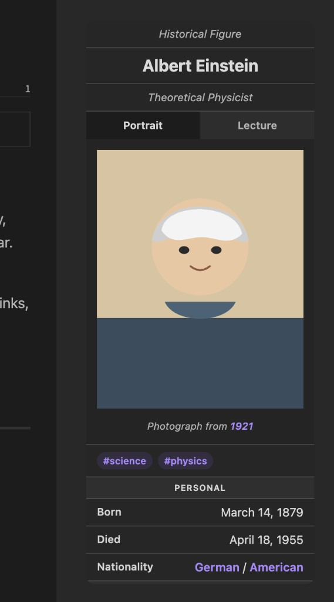

# Quartz Infobox

A [Quartz 5](https://quartz.jzhao.xyz/) component that renders a Wikipedia-style infobox from note frontmatter. The frontmatter schema matches [Omni Infobox](https://github.com/omni-gh549/obsidian-infobox), so the same notes work in Obsidian and on a Quartz site.

The card sits at the top of Quartz's right sidebar. Colors use Quartz theme tokens, so the card follows light and dark mode.



## Frontmatter

```yaml
---
title: Albert Einstein
tags:
  - science
infobox:
  supertitle: Historical Figure
  title: Albert Einstein
  subtitle: Theoretical Physicist
  images:
    - label: Portrait
      image: einstein-portrait.svg
      caption: Photograph from [[1921]]
    - label: Lecture
      image: einstein-lecture.svg
      caption: Einstein giving a lecture
  tags: [science, physics]
  showTags: true
  fields:
    - section: Personal
    - Born: March 14, 1879
    - Nationality: "[[Germany|German]] / [[United States|American]]"
    - section: Career
    - Known for: "[[General Relativity]] | [[Special Relativity]]"
---
```

Notes without an `infobox` object do not get a card. `showTags: false` hides tags. If `tags` is omitted, the note's own frontmatter tags are used.

Field values follow the Obsidian plugin:

- a `section` key becomes a divider
- YAML arrays, bullet lines, pipes (`|`), semicolons, and commas render as lists
- commas inside dates such as `March 14, 1879` stay as one line
- pipes and commas inside `[[wikilinks]]` are left alone
- a YAML block scalar can contain Markdown headings and bullets

Images can be a vault-relative path, a filename anywhere in the content folder, a wikilink, or an `http` URL. `image` plus `caption` is the single-image form of `images`.

## Install

From a Quartz 5 site:

```bash
npx quartz plugin add github:oilandrust/quartz-infobox-plugin
```

The plugin registers itself in the right sidebar. To place it by hand:

```yaml
plugins:
  - source: github:oilandrust/quartz-infobox-plugin
    enabled: true
    options:
      fallbackToNoteTags: true
    layout:
      position: right
      priority: 5
```

A lower priority renders higher in the sidebar. `fallbackToNoteTags` uses the note's own tags when the infobox does not list any.

## Develop

```bash
npm install
npm test
npm run build
```

Commit `dist/` after a build. Quartz installs that prebuilt output and skips a local compile.
